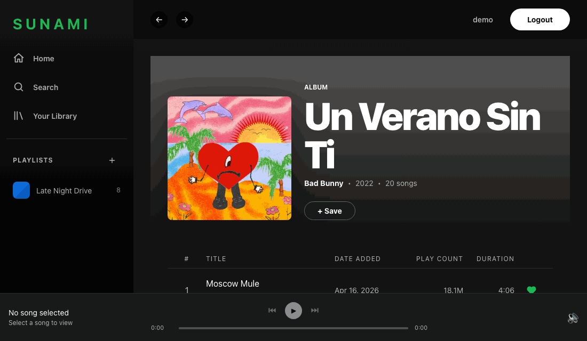
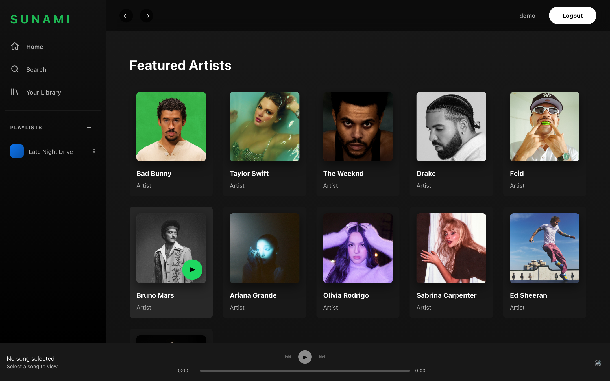
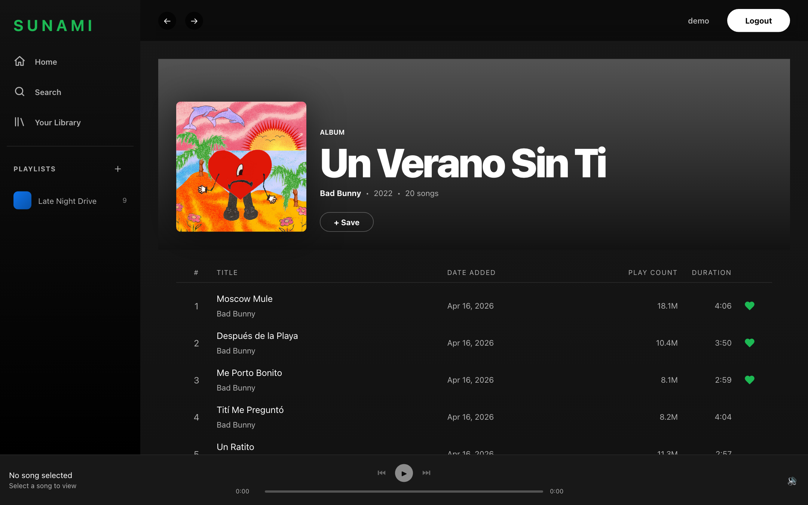
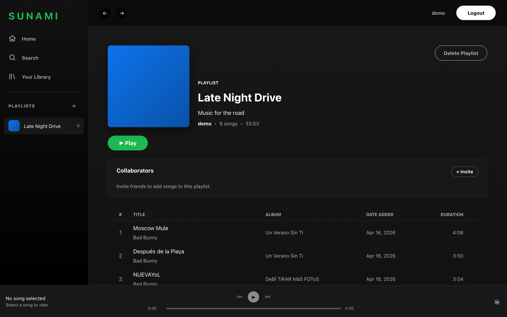
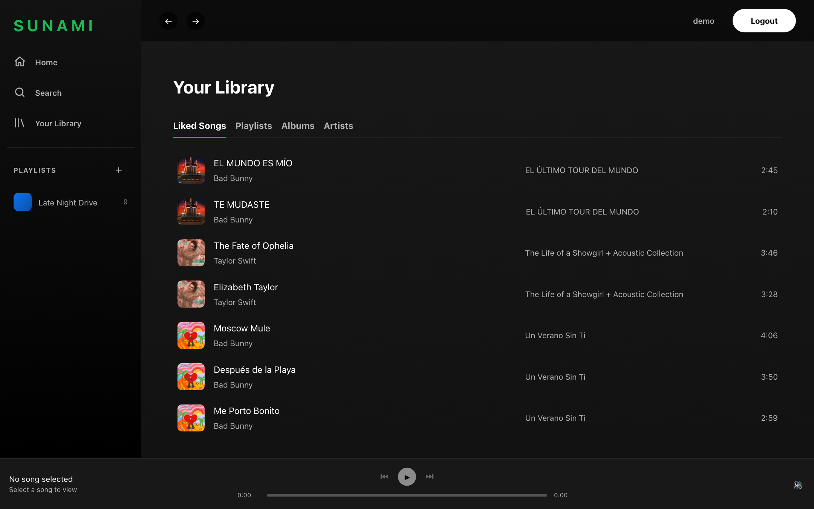
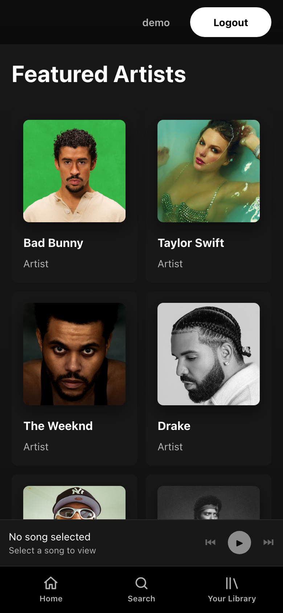
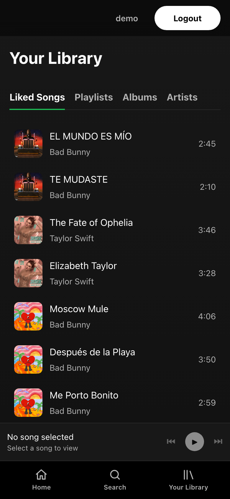

# Sunami

A full-stack music app inspired by Spotify. Browse artists and albums, like songs, build playlists, and invite friends to collaborate. Built to demonstrate modern full-stack development with React, Node.js and MongoDB.

**Live demo:** [sunami-fe.vercel.app](https://sunami-fe.vercel.app)

> **Try it without signing up:** log in with username `demo` and password `Demo1234`, or register your own account in a few seconds.
>
> **Heads up:** the backend runs on a free serverless tier, so the very first request after a quiet period can take a few seconds.



| | |
|---|---|
|  |  |
|  |  |

**Mobile-friendly:** the layout adapts to phones with a bottom tab bar, a compact mini-player and slimmed-down track lists.

<p>
  
  
  
</p>

### About playback

Sunami doesn't host any audio. Every song stores its Spotify link, so **pressing play opens the track on Spotify**. The bottom player tracks what you selected and lets you step through the queue.

---

## Tech Stack

| Layer | Technology |
|---|---|
| Frontend | React 19, React Router 7, Vite, CSS Modules |
| Backend | Node.js, Express, MongoDB Atlas, Mongoose |
| Auth | JWT access tokens + httpOnly refresh token cookies |
| Testing | Vitest, MongoDB Memory Server |

---

## Features

- **Auth** — Register, login, logout with access/refresh token rotation. Refresh tokens stored in httpOnly cookies (XSS-safe). Auto-refresh on 401.
- **Browse** — Artists, albums, songs, and public playlists. Debounced search across all content types.
- **Library** — Like songs, save albums, follow artists and playlists. Optimistic UI updates.
- **Playlists** — Create, edit, delete playlists. Invite collaborators by username. Follow public playlists from other users.
- **Player** — Persistent bottom player with prev/next queue navigation. Currently-playing indicator on song rows.
- **Responsive** — Works on desktop, tablet and phone.
- **Admin** — Role-based access control. Admins can create curated "Sunami Playlists" and manage all content.

---

## Architecture

```
backend/
├── controllers/     # Request handling and business logic
├── repositories/    # Data access layer (Mongoose queries)
├── models/          # Mongoose schemas
├── routes/          # Express route definitions
├── middleware/      # Auth, validation, error handling
├── utils/           # AppError, catchAsync, token helpers
└── scripts/         # DB seeding and admin utilities

frontend/src/
├── pages/           # Route-level components
├── components/      # Reusable UI components
├── context/         # Auth, Player, Library (React Context)
├── hooks/           # useAuth, usePlayer, useLibrary, useToast
├── services/        # API call wrappers
├── utils/           # Date, duration, number formatters
└── constants/       # Route paths, API endpoints
```

The backend follows a strict layered architecture: routes → controllers → repositories → models. Controllers never touch Mongoose directly — all DB access goes through the repository layer.

---

## Getting Started

### Backend

```bash
cd backend
npm install
cp .env.example .env
# Fill in MONGODB_URI, JWT_ACCESS_SECRET, JWT_REFRESH_SECRET
npm run generate:secrets   # auto-generates JWT secrets
npm run seed:admin         # creates an admin user
npm run seed               # seeds music data from Spotify export
npm run dev                # starts on http://localhost:3000
```

### Frontend

```bash
cd frontend
npm install
npm run dev                # starts on http://localhost:5173
```

Set `VITE_API_URL` in `frontend/.env` if your backend runs on a different port.

---

## Environment Variables

**Backend `.env`:**

```env
MONGODB_URI=mongodb+srv://...
JWT_ACCESS_SECRET=...
JWT_REFRESH_SECRET=...
JWT_ACCESS_EXPIRES=15m
JWT_REFRESH_EXPIRES=7d
PORT=3000
NODE_ENV=development
FRONTEND_URL=http://localhost:5173
ADMIN_USERNAME=admin
ADMIN_EMAIL=admin@example.com
ADMIN_PASSWORD=...
```

---

## API Overview

**Public**
```
POST   /api/auth/register
POST   /api/auth/login
POST   /api/auth/refresh
GET    /api/artists
GET    /api/albums
GET    /api/songs?q=query
GET    /api/playlists/public
```

**Authenticated**
```
GET    /api/users/me/library
POST   /api/users/me/songs/:id      # like/unlike
POST   /api/users/me/albums/:id     # save/unsave
POST   /api/users/me/artists/:id    # follow/unfollow
POST   /api/playlists
PUT    /api/playlists/:id
POST   /api/playlists/:id/songs       # body: { songId }
POST   /api/playlists/:id/follow
POST   /api/playlists/:id/collaborators
POST   /api/auth/logout
```

**Admin only**
```
POST   /api/artists
PUT    /api/artists/:id
DELETE /api/artists/:id
POST   /api/songs
POST   /api/albums
```

---

## Design Decisions

- **Refresh token in httpOnly cookie** — The access token (15 min TTL) lives in `localStorage` for simplicity; the refresh token (7 days) is httpOnly to prevent XSS access. On every 401, the frontend automatically retries with a fresh access token before failing.
- **Repository pattern** — Keeps controllers thin and makes the data layer swappable and independently testable.
- **Optimistic UI** — Library actions (like, save, follow) update the local React context immediately without waiting for a re-fetch, so the UI feels instant.
- **No audio hosting** — Songs include a `spotifyUrl` field. The player links out to Spotify rather than self-hosting audio files.
